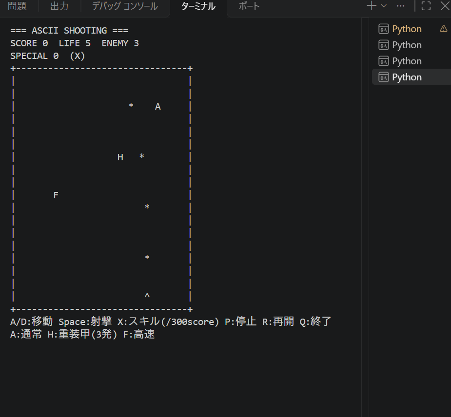

### シューティング `shooting.py` ★★★～★★★★★

## 1. ゲームタイトル

**ASCII SHOOTING（ASCIIインベーダー風シューティングゲーム）**

## 2. ゲームの概要

プレイヤーを左右に移動させながら、上から降ってくる敵を弾で撃ち落としてスコアを稼ぐシューティングゲームです。

敵には通常敵・重装甲敵・高速敵の3種類があり、それぞれHPや降下速度、獲得できる得点が異なります。

敵がプレイヤーの位置まで到達するとライフが減少し、ライフが0になるとゲームオーバーになります。

スコアに応じて敵の出現頻度が上がるほか、3方向射撃や画面上の敵を一掃する特殊攻撃を使用できます。

## 3. 動作環境

- OS：Windows 10 / 11 など
- Python：Python 3
- 必要なライブラリ：Python標準ライブラリのみ
- 外部ライブラリのインストール：不要

※ `terminal_io.py` が必要です。`shooting.py` と同じフォルダーに配置してください。

## 4. インストール方法

### ① Pythonの準備

Pythonがインストールされていない場合は、公式サイトからPython 3をインストールしてください。

https://www.python.org/downloads/

### ② ファイルの準備

以下の2つのファイルを同じフォルダーに配置します。

```text
shooting_game/
├── shooting.py
└── terminal_io.py
```

### ③ ファイルの確認

`shooting.py` と `terminal_io.py` の両方が同じフォルダーに存在することを確認してください。

## 5. 起動方法

1. コマンドプロンプトまたはターミナルを開きます。
2. ゲームのファイルが保存されているフォルダーに移動します。
3. 以下のコマンドを実行します。

```bash
python shooting.py
```

4. 「Enterで開始 / Qで終了」と表示されたら、Enterキーを押すとゲームが始まります。

※ 環境によっては `python` の代わりに `py` を使用してください。

## 6. 操作方法・ゲームルール

### キー操作

| キー | 操作 |
|---|---|
| A / ← | 左に移動 |
| D / → | 右に移動 |
| Space | 弾を発射 |
| X | 特殊攻撃を使用 |
| P | 一時停止・再開 |
| R | ゲームをリスタート |
| Q | ゲームを終了 |

### ゲームルール

- プレイヤーを左右に移動させ、敵に向かって弾を発射します。
- 弾が敵に命中すると敵のHPが減少します。
- 敵のHPが0になると撃墜でき、得点を獲得できます。
- 敵がプレイヤーの位置まで到達するとライフが1減少します。
- 初期ライフは5で、ライフが0になるとゲームオーバーです。
- スコアが高くなるほど敵の出現頻度が上がります。

### 敵の種類

| 敵 | 特徴 | HP | 得点 |
|---|---|---:|---:|
| A：通常敵 | 標準的な敵 | 1 | 10点 |
| H：重装甲敵 | 撃墜するまでに3発必要 | 3 | 30点 |
| F：高速敵 | 他の敵より速く降下する | 1 | 20点 |

## 7. 追加・改良した機能

オリジナル版から、以下の機能を追加・変更しました。

- **ライフの増加：** プレイヤーの初期ライフを3から5に変更しました。
- **3方向射撃：** スコアが400点以上になると、横に並んだ3か所から同時に弾を発射できるようにしました。
- **特殊攻撃：** 300点獲得するごとに1回使用できる機能を追加しました。使用すると画面上の敵をすべて撃墜し、それぞれの敵の得点も獲得できます。
- **敵の出現頻度の変化：** スコアが上がるほど敵の出現間隔が短くなるようにしました。
- **敵の種類のランダム化：** 通常敵・重装甲敵・高速敵が異なる確率で出現するようにしました。

## 8. 実行画面

以下にゲームの実行画面を掲載します。

<!-- shooting.py を実行した画面のスクリーンショットをここに貼り付ける -->



※ スクリーンショットを `images` フォルダーに保存し、ファイル名を `shooting_screenshot.png` にしてください。

## 9. 既知の問題・制限事項

- 画面は文字を使って表示するため、一般的な画像を使用したゲームとは見た目が異なります。
- 敵と弾の命中判定は、弾と敵の座標が完全に一致した場合に行われます。
- 特殊攻撃は画面上の敵を一掃できますが、使用回数には制限があります。
- `terminal_io.py` がない場合、ゲームを起動できません。
- ゲームの画面表示やキー入力は、実行するターミナルの環境によって動作が異なる場合があります。

## 10. クレジット

- 制作言語：Python
- ベース：授業で配布されたASCIIインベーダー風シューティングゲームの教材
- 画面表示・キー入力：`terminal_io.py`
- 追加機能の実装・改良：自作